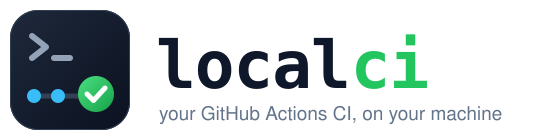

<p align="center">
  
</p>

<p align="center">
  <a href="https://github.com/peters/localci/actions/workflows/ci.yml"></a>
  <a href="https://github.com/peters/localci/releases"></a>
  <a href="LICENSE"></a>
</p>

Waiting for GitHub to pick up your push, queue a runner and rebuild everything
from a cold cache is slow. Sometimes GitHub is just down. **localci runs your
existing `.github/workflows/ci.yml` on your own machine, in seconds, with your
build cache still warm.**

- **No new config.** It reads the workflows you already have.
- **Your OS, your jobs.** It runs the jobs whose `runs-on` matches your machine (Linux, macOS or Windows) and tells you which ones need another OS.
- **Real steps.** Shell steps, matrices, `needs`, outputs, `GITHUB_ENV`, `if:` conditions and `services:` (as Docker containers) behave like they do on GitHub. Setup actions such as `actions/checkout` are skipped, because your machine already has the checkout and the tools.
- **Made for agents.** One command teaches Claude Code, Codex and other agents to run the right subset of your CI before they push.
- **Tiny.** One static binary, about 600 KB to download, installed in under 2 seconds.

## The numbers

Measured on [Horizon](https://github.com/peters/horizon), a public Rust
workspace with a Linux, macOS and Windows CI matrix, on 10 October 2026.

**Waiting for GitHub vs. checking locally**

| | Time |
|---|---|
| One GitHub CI run, push to result (median of 18 runs) | **27 minutes** |
| Same Linux jobs with `localci run`, one after another | 15 to 23 minutes |
| Same change with `localci run --fast` | **2 minutes 16 seconds** |
| `localci run --fast` again, nothing changed | **0 seconds** |
| A failing CI test, found by `localci run repo-checks` before any push | **4 seconds** |

**What it saves on a pull request.** Without localci, every push starts a full
CI run of about 62 runner-minutes, and a fix round waits for it. In the last
40 merged Horizon PRs:

| | Review rounds | CI runs | Runner time |
|---|---|---|---|
| Small PRs (5 files or fewer), median | 1 | 1 | 63 min |
| Large PRs (more than 10 files), median | 5 | 5 | 307 min |
| Large PR with localci and the skill's PR loop (estimate) | 5 | 2 | about 125 min |

With the PR loop, each fix is checked locally and pushed without a CI run. CI
runs on the first and the last push only. For a large PR that is about
**1½ hours less waiting** and **about 3 hours less runner time**.

**A real PR** ([peters/horizon#1461](https://github.com/peters/horizon/pull/1461)):
localci found 2 failures before the first push. The review approved it
9 minutes after it opened. It had 4 pushes and 2 CI runs; without localci it
would have had 4 CI runs.

## Quick start

**macOS and Linux**

```sh
curl -fsSL https://raw.githubusercontent.com/peters/localci/main/install.sh | sh
```

**Windows (PowerShell)**

```powershell
irm https://raw.githubusercontent.com/peters/localci/main/install.ps1 | iex
```

Then, in any repository with GitHub Actions:

```sh
localci list     # every job and matrix leg, and which run here
localci run      # run them
```

Prebuilt binaries cover Linux x64 and arm64 (static), macOS Apple silicon and
Intel, and Windows x64. With Rust installed you can also build it yourself in
about 10 seconds: `cargo install --locked --git https://github.com/peters/localci`.

## Onboard your agent

```sh
localci skill install
```

This puts a skill into `~/.claude/skills`, `~/.codex/skills` and
`~/.agents/skills` (for each agent you have). From then on, just ask:

> Run CI locally before you push.

The agent looks at the plan and your diff, suggests which jobs and steps are
worth running, asks you once, runs them, and reads only the log of a step that
failed. It knows that a local run is a fast pre-check and not the real GitHub
result.

## Everyday use

```sh
localci plan                          # what would run, step by step, without running it
localci run clippy                    # one job, by id
localci run "linux x64 libs"          # one matrix leg, by name
localci run --matrix shard=libs       # legs with that matrix value
localci run --skip-setup              # leave out apt-get, brew and installer steps
localci run --skip "slow tests"       # leave out steps by name or command
localci run --only lint               # run only matching steps
localci run -k                        # keep going after a failing job
localci run -w release                # another workflow file
localci check                         # can localci handle every workflow here?
```

Add `--json -q` for a machine-readable report. Each step's log is kept, and the
path is printed at the end.

### Fast mode

```sh
localci run --fast
```

`--fast` is three things at once:

- `--affected`: leave out build and test steps (Cargo, npm, dotnet, Go, Gradle,
  Swift) when none of their inputs changed since your branch left the default
  branch. A step whose commands localci cannot read always runs.
- `--cache`: reuse a step that already passed on the same inputs, including its outputs.
- `--parallel 0`: run independent jobs at the same time (2 to 4, from the CPU count).

On Horizon, a documentation and CI change went from a 23-minute full Linux run
to 136 seconds with `--fast`, and to 0 seconds for a second run with no changes. `localci plan --affected` shows why each step runs
or not. Run once without `--fast` before you push for review.

## Skip things locally, keep them on GitHub

Some steps should never run on your laptop, like `sudo apt-get install` or a
deploy job. Mark them with a normal GitHub condition. localci sets `LOCALCI`,
and on GitHub it is empty, so GitHub keeps running them:

```yaml
jobs:
  deploy:
    if: ${{ !vars.LOCALCI }}          # jobs: use vars
    ...
  test:
    steps:
      - name: Install system packages
        if: ${{ !env.LOCALCI }}       # steps: env or vars
        run: sudo apt-get install -y libssl-dev
```

## Services

Jobs with `services:` (PostgreSQL, Redis and so on) get real Docker containers
with their health checks and port mappings, removed when the job ends. If you
already run those services yourself, add `--no-services`. Set
`LOCALCI_DOCKER=podman` to use Podman.

## What it does not do

- Run jobs for another OS. Run localci on that machine instead.
- Run `uses:` actions, reusable workflows or `container:` jobs.
- Post results to GitHub. GitHub CI stays the final word.

The [compatibility table](docs/compatibility.md) lists every feature, and the
[decision records](docs/adr/README.md) explain why.

## Found a difference from GitHub?

Every bug becomes a small folder in [`tests/cases/`](tests/cases): a workflow
and the result it should give. No Rust code needed. See
[the procedure](docs/procedures/add-a-regression-case.md), and please open an
issue or a pull request.

## License

MIT
